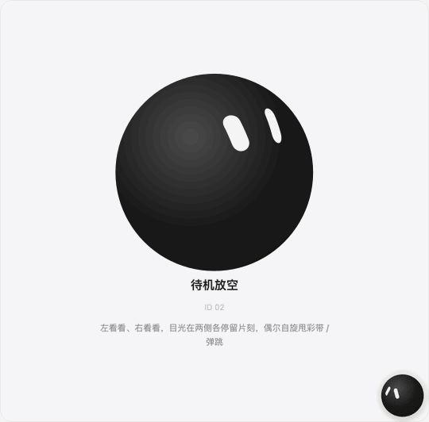
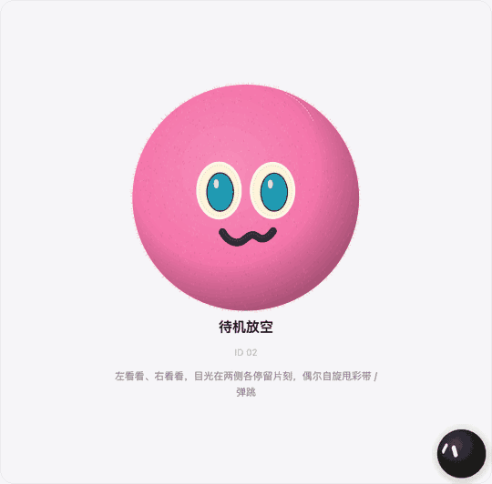
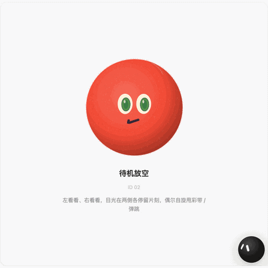
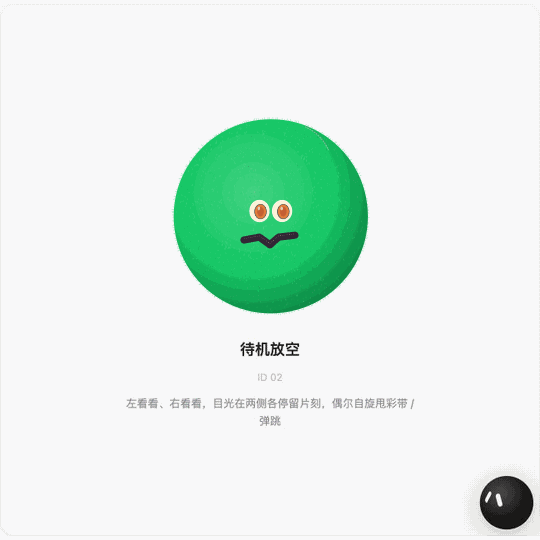
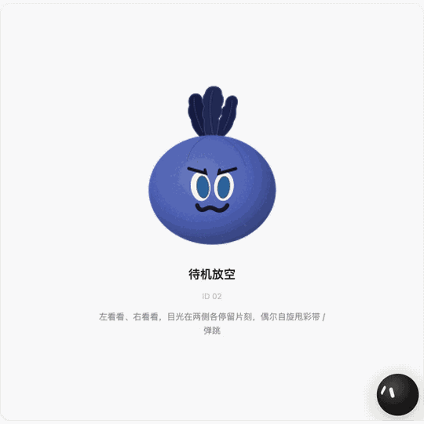
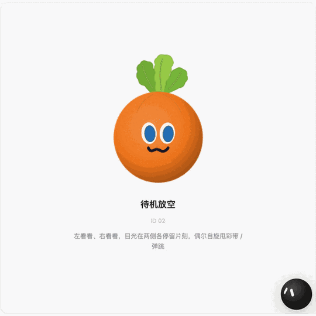

# Grok Ball Pro · 五月天同人舞台 🎵

[](https://ashintop.github.io/grok-ball-pro/)

▶ **[在线试玩 · Play online](https://ashintop.github.io/grok-ball-pro/)**　·　[表情动图](#九款球体动态预览)　·　[原版演示](#经典版在线演示与示例)　·　[开发接入](#表情与开发)

🎭 **9 款球体 × 42 种表情**　｜　🎸 **五月天同人舞台**　｜　🛠️ **单文件 SVG**　｜　📄 **[MIT](./LICENSE)**

一个可以放在浏览器里的迷你安可现场。用鼠标和表情球互动，在 **9 款球体 × 42 个表情**里自由搭配，再点「安可一下」让当前球转圈、撒彩纸。五位团员的球登场时，旁边还会亮起各自的演出道具。一个 HTML 即可离线运行，不需要安装应用、连接 AI 或登录。

Grok Ball Pro 延续 TyCoding 的鼠标注视、SVG 表情与 Agent 状态接口，在经典眼环之外加入五月天同人舞台和七款毛绒造型。

> **非官方同人项目**。角色是用 SVG 绘制的二次创作，不是官方周边，也不是五月天、相信音乐、STAYREAL 或 xAI 的合作项目。

## 特性

- **沿用原版表情引擎**：保留原有 25 组眼环几何和经典球面投影。移动鼠标，预览球与右下角小球会跟随注视；点击右下角小球可触发自旋与 3D 彩带。
- **经典动画与同人造型并存**：逐点眼环形变、眨眼、呼吸、睡眠 zzz、任务完成撒花继续保留；Pro 可独立切换 9 款球体与 42 种表情。
- **单 HTML 试玩、可嵌入业务**：内联 SVG 运行时无需安装，支持 JS、TypeScript 和 `emotionId`；官方登场曲是可选的联网内容。

## 🎛️ 怎样玩

1. 打开 [在线试玩](https://ashintop.github.io/grok-ball-pro/)；也可下载或克隆本仓库，用浏览器打开 [`index.html`](./index.html) 离线体验。
2. 在工作台选球体、再选表情。两个选择互不覆盖；浏览器允许本地存储时，刷新后会恢复上一次搭配。
3. 打开「五月天手册」，读乐团介绍、点一位团员切换对应球体，或跳转官方 MV 和演唱会现场。点击「安可一下」只触发视觉效果，不换球、不换表情、不自动播歌。系统开启「减少动态效果」时，安可不会触发转圈或撒彩纸。

## 🎶 五位团员的登场曲

选到成员球后，舞台会显示「登场曲」。每首都是五月天本团作品；按演唱、作曲或编曲的角色联想挑选，不冒称官方指定曲、独奏或独立乐器分轨。

| 团员 | 五月天歌曲 | 选择缘由 |
| --- | --- | --- |
| 阿信 · 主唱 | [〈干杯〉](https://www.youtube.com/watch?v=qX2GsMj7154) | 从主唱叙事到合唱。 |
| 怪兽 · 吉他 | [〈九号球〉](https://www.youtube.com/watch?v=srP_Fm7f-eg) | 怪兽作曲；电吉他与乐团的情绪一起渐强。 |
| 玛莎 · 贝斯 | [〈诺亚方舟〉](https://www.youtube.com/watch?v=V46K7apDziA) | 玛莎作曲；可以留意低频与全团逐渐推高的编曲。 |
| 石头 · 吉他 | [〈如烟〉](https://www.youtube.com/watch?v=uzVdsZbYibQ) | 石头作曲；链接是五月天与周深的官方现场。 |
| 冠佑 · 鼓 | [〈夜访吸血鬼〉](https://www.youtube.com/watch?v=03-ge__OaIU) | 冠佑作曲；用鼓点和摇摆节奏呈现另一种气氛。 |

HTTP(S) 网页可按需加载**可见的 YouTube 官方播放器**，默认不连接和不自动播；关闭或切出页面会停止。本地双击 HTML 则用「打开官方视频」，不依赖嵌入。若影片在你的地区或当前网站禁止嵌入，可直接前往官方视频。页面不提取、不重传原音，也不用隐藏播放器当背景音乐。

## 九款球体动态预览

白球沿用 fork 原 README 的完整动图，未裁剪、放大或抽帧。其他八款按「待机放空 → 开心 → 惊讶 → 生气 → 思考中 → 任务完成」轮换，每段保留眨眼和视线动作；球身在**原文件**中宽、高均超过 200 px（不含头饰）。下方两栏全部展开，点击任一动图可按原尺寸查看。

| ⚪ 经典白球（原版） | ⚫ 经典黑球 |
| :---: | :---: |
| [](./assets/promo/10-expression-switch.gif) | [](./assets/pro-expressions/midnight.gif) |
| **🎙️ 阿信粉球** | **🎸 怪兽红球** |
| [](./assets/pro-expressions/encore.gif) | [](./assets/pro-expressions/red.gif) |
| **🟡 玛莎黄球** | **🎸 石头绿球** |
| [](./assets/pro-expressions/sunshine.gif) | [](./assets/pro-expressions/jade.gif) |
| **🥁 冠佑眼镜蓝球** | **💙 蓝色梦想倔强卜卜** |
| [](./assets/pro-expressions/backbeat.gif) | [](./assets/pro-expressions/night-seed.gif) |
| **🥕 胡萝卜卜卜** |  |
| [](./assets/pro-expressions/sprout.gif) |  |

完整 42 种表情可在 [`index.html`](./index.html) 互动体验。

## 经典版在线演示与示例

[试用原版 Grok Ball](https://tycoding.github.io/grok-ball/)。以下是 TyCoding 原版截图，不是 Pro 舞台界面。


| 情绪反应 | Agent 工作状态 |
| :---: | :---: |
| [](./assets/promo/12-emotion-grid.png) | [](./assets/promo/13-agent-grid.png) |

更多原版示例：[睡眠状态](./assets/promo/02-sleeping.png) · [思考环带](./assets/promo/07-thinking-orbit.png) · [任务完成](./assets/promo/08-task-done.png) · [表情切换 MP4](./assets/promo/11-expression-switch.mp4)。

## 🎤 认识五月天（Mayday）

五月天是来自台湾的五人摇滚乐团。1997 年，他们以五月天的名字在台北野台开唱演出；1999 年发行《五月天第一张创作专辑》。〈志明与春娇〉把台语写进摇滚乐，而后来的专辑从青春与梦想写到友情、时间与回望。想了解乐团不同阶段的作品，可从[相信音乐的官方艺人页](https://bin-music.com/artist/MAYDAY)继续找专辑、MV 和巡演资料；[中央社的成军回顾](https://www.cna.com.tw/news/amov/201703295024.aspx)记录了早期现场与出道经过。

| 团员 | 乐团分工 | 本站对应的同人球体 | 舞台道具 | SDK ID |
| --- | --- | --- | --- | --- |
| 阿信（陈信宏） | 主唱 | 阿信粉球 | 话筒与「主唱大人」铭牌 | `encore` |
| 怪兽（温尚翊） | 吉他、团长 | 怪兽红球 | 红色电吉他 | `red` |
| 玛莎（蔡昇晏） | 贝斯 | 玛莎黄球 | 四弦贝斯 | `sunshine` |
| 石头（石锦航） | 吉他 | 石头绿球 | 绿色电吉他 | `jade` |
| 冠佑（刘冠佑） | 鼓 | 冠佑眼镜蓝球 | 架子鼓 | `backbeat` |

### 第一次听，可以从三首入门

| 站点 | 推荐曲目 | 为什么选这一首 |
| --- | --- | --- |
| 1999 ·《五月天第一张创作专辑》 | [〈志明与春娇〉官方 MV](https://www.youtube.com/watch?v=5VUUGZ1-nlY) | 从台语叙事和吉他听见早期五月天。 |
| 2008 ·《后青春期的诗》 | [〈突然好想你〉官方现场](https://www.youtube.com/watch?v=EZxVmhM6UpE) | 从克制的主歌到合唱；链接是后来与李荣浩、萧敬腾、毛不易同台的版本。 |
| 2016 · [《自传》](https://www.sonymusic.com.tw/album/%E8%87%AA%E5%82%B3-%E4%BA%94%E6%9C%88%E5%A4%A9-mayday-bd0102/) | [〈转眼〉官方 MV](https://www.youtube.com/watch?v=LQ2s10P5i08) | 以一生回望时间，也是《自传》的收尾曲。链接为「2018 自传最终章」影像。 |

### 从专辑走到演唱会

《第二人生》把“如果末日没有发生，接下来怎么活”当成专辑概念，围绕这张专辑展开的世界巡演主题曲[〈诺亚方舟〉](https://www.youtube.com/watch?v=V46K7apDziA)适合接着听。《自传》后来又延伸成「人生无限公司」巡演：同一首歌，在唱片里是一个人的回忆，在现场可以变成全场的合唱。这也是网页把“选成员”做成“点名上台”、把动画按钮做成“安可”的原因。[相信音乐的专辑及巡演资料](https://bin-music.com/artist/MAYDAY)

## 🧵 球体为什么长这样？

- **五色成员球**：参考[相信音乐 #5525 表情包包球吊饰](https://www.shopping.bin-music.com.tw/SalePage/Index/10286583)的配色和辨识特征，用 SVG 画出绒面、缝线、眼眉和配件。上表的球名是本站名称，不是商品正式品名。
- **两款卜卜**：另参考 STAYREAL 的[蓝色梦想倔强卜卜](https://hkmall.istayreal.com/products/lk26013)与[胡萝卜绒毛公仔](https://hkmall.istayreal.com/products/lf24002)，并不对应团员。胡萝卜卜卜默认是蓝眼小笑，选择「星光眼」可看到受 [Wow 哇卜卜](https://hkmall.istayreal.com/products/lf26009)启发的星眼。
- **白眉笑**：参考 [5555 表情包包球图鉴](https://koca.shop/zh-TW/batches/56538)的白眉和白须细节。网页里的表情组合是二次创作，不代表现实中有同款商品。
- **经典原版与经典黑球**：保留两款经典球及眼环绘制方式，与五月天主题独立。

蓝紫灯束、五色灯点、舞台排版和乐器剪影均为网页自绘。道具仅显示在试玩舞台，不改变球体的 SVG、表情或上方的引擎动图，也不照搬任何一场官方演唱会的主视觉。本页不打包音乐、歌词、官方照片、参考原图或官方标识；上面的试听由官方平台提供，主动选择才连接。

## 表情与开发

原版 32 个表情 ID、原有 SDK 和 Agent 消息格式都继续可用。新增 ID：`22` 星光眼、`23` 俏皮眨眼、`24` 哇哦、`25` 心动、`42` 白眉笑、`43` 放空、`44` 认真脸、`45` 探头看看、`46` 委屈巴巴、`47` 笑出眼泪。

```js
// 先在浏览器中引入 ./src/grok-ball.js；#mount 是你的挂载元素。
const ball = GrokBall.create('#mount', { body: 'sprout', emotion: '22' });
ball.setBody('backbeat'); // 只换球体
ball.handleAIMessage({ emotionId: '25' }); // 只换表情
ball.setGaze(0.5, -0.3); // 让球注视指定方向
// 不再需要时：ball.destroy();
```

省略 `body` 沿用原版外观。`body` 决定主题；原有的 `shape` 决定球面几何。TypeScript 项目可用 [`src/grok-ball.ts`](./src/grok-ball.ts)，更完整的原有接入说明见 [SKILL.md](./SKILL.md)。

### 原版 32 个表情 ID

| 分组 | 表情 ID |
| --- | --- |
| 生命周期 | 00 睡眠 · 01 唤醒 · 02 待机放空 · 03 好奇 · 04 发呆 · 05 加载苏醒 · 06 休眠 · 07 抖动唤醒 |
| 情绪反应 | 10 开心 · 11 疑惑 · 12 失落 · 13 惊讶 · 14 害羞 · 15 疲惫 · 16 专注 · 17 慌张 · 18 无奈 · 19 满意 · 20 困惑 · 21 生气 |
| 代理工作状态 | 30 思考中 · 31 接收任务 · 32 处理中忙碌 · 33 任务完成 · 34 出错 · 35 等待输入 · 36 联网加载 · 37 复述回忆 · 38 拒绝/受限 · 39 输出回复 · 40 检索资料 · 41 停止终止 |

### 目录结构

```text
index.html                  单文件试玩（内联引擎 + 舞台）
src/grok-ball.js            SVG 引擎、表情配置与浏览器 SDK
src/grok-ball.ts            TypeScript 接口与 Agent 消息类型
scripts/build-inline.mjs    把引擎压缩并内联到 index.html
scripts/test-grok-ball.mjs  表情、切换和舞台互动回归检查
assets/promo/               上游原版截图、GIF 和 MP4
assets/pro-expressions/     Pro 各球体动图
AGENTS.md / SKILL.md        开发及接入指南
LICENSE                     MIT 许可证
```

### 给 AI 助手的接入提示

可复制下面这段给你的编程助手：

```text
请先阅读 https://github.com/AshinTop/grok-ball-pro 的 SKILL.md 和 AGENTS.md。
用 GrokBall.create() 在我的项目接入表情球，根据已有 emotionId 切换状态。
如需 Pro 的球体切换，请以 src/grok-ball.ts 的接口及当前 README 为准，
保留表情状态与球体选择相互独立，并在组件卸载时调用 destroy()。
```

### 构建与验证

```bash
node --check src/grok-ball.js
# 只在引擎源码变动时重新生成内联引擎
node scripts/build-inline.mjs
node scripts/test-grok-ball.mjs
tsc --noEmit --target ES2020 --module ES2020 --moduleResolution bundler --lib ES2020,DOM src/grok-ball.ts
```

[`src/grok-ball.js`](./src/grok-ball.js) 是引擎真源；[`index.html`](./index.html) 内联同一引擎，另外包含舞台和手册。Terser 是构建工具，不是成品运行依赖。

## 致谢与许可证

本项目从 [TyCoding/grok-ball](https://github.com/TyCoding/grok-ball) fork，保留原始 [MIT 许可证](./LICENSE)、眼环实现及表情接口。[上游在线演示](https://tycoding.github.io/grok-ball/)和 [`assets/promo/`](./assets/promo/) 里的旧图展示的是原版，不是本页的五月天主题。MIT 覆盖本仓库按其条款提供的代码，不授予第三方音乐、照片、角色或商标的使用权。
